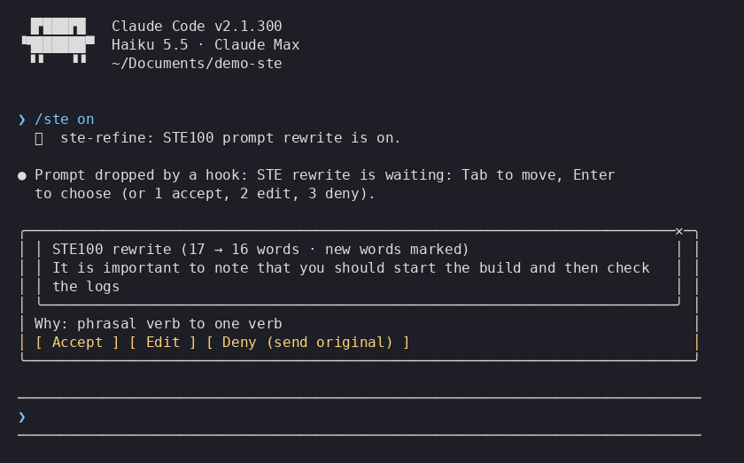

# cc-ste-mod

A Claude Code mod (`ste-refine`) that rewrites your prompt in ASD-STE100 Simplified Technical English before Claude reads it. You see the rewrite first and choose to accept it, edit it, or send your original.



The rewrite rules come from the [asd-ste100 skill](https://github.com/danyuchn/asd-ste100-skill): short sentences, active voice, one instruction per sentence, no phrasal verbs, no stacked hedges. Code, paths, identifiers, numbers and hedges stay as you wrote them.

## How it works

1. Type a prompt and press Enter.
2. The mod holds the prompt and asks a small model (`claude-haiku-5-5` by default) for an STE100 rewrite. A status line under the prompt shows while it works. To stop the wait and send the prompt as typed, run `/ste skip`. No box opens unless there is a rewrite to review.
3. A pane opens with your original and the rewrite, and it takes the keyboard. Words that are new in the rewrite are highlighted, and the title shows the word count before and after. A **Why** line names up to three STE rules that the rewrite applied. If the rewrite lost a code span, URL, path, number or negation ("not", "never", "no", "don't") from your prompt, a warning line names it, and **Edit** is selected first, so Enter does not accept it by mistake. Otherwise **Accept** is selected first, so Enter accepts:
   - **Tab** moves between **Accept**, **Edit** and **Deny**. From **Deny**, Tab goes back to **Accept**.
   - **Enter** presses the selected button. `1`, `2` and `3` press them directly.
   - **Esc** or the close mark closes the pane and keeps the rewrite waiting in the band above the prompt. A toast tells you where it went.
   - While the pane is open, toasts wait behind it and show after you choose.
4. **Accept** sends the rewrite. **Deny** sends your original prompt unchanged. **Edit** opens the rewrite in a field: press Enter to send what is in it, or **Back** to return.
5. After you deny 3 rewrites in a row, the review shows **Deny and pause for this session** (`p`). A toast also tells you about `/ste pause`. Accept or Edit starts the count again.

When the pane cannot open, the rewrite shows in the band above the prompt instead. The band takes the keyboard only after `ctrl+x tab` or a click. When it does, the mod opens the pane, because the arrow keys in the band stay with Claude Code. If the pane cannot open, Tab and Enter work in the band, and with an empty prompt box `1`, `2` and `3` work at once. **Open in pane** (`4`) or `/ste review` opens the pane again.

Each view shows a line of key hints under its buttons.

The mod sends the prompt unchanged, without a rewrite, when:

- the prompt starts with `*` (the mod removes the `*`)
- the prompt is a slash command, or has fewer than 4 words
- the prompt is simple: 20 words or fewer, with no phrasal verb ("kick off", "set up"), no passive verb ("is deleted") and no semicolon. Text in code spans, paths and URLs does not count. For example, `commit and push code` goes as typed.
- the prompt has an image or file attached
- you type it while a turn is running
- the prompt is not in English, or already follows STE100
- the rewrite only adds or removes small words such as "the", "then" or "and", and splits no long sentence
- the model call fails (a toast says why)

## Commands

```
/ste status   show whether the rewrite is on, and the model
/ste review   open the waiting rewrite in its pane again
/ste skip     stop a rewrite that is running and send the prompt as typed
/ste glossary on|off   follow CONTEXT.md in the project (off by default, kept across sessions)
/ste check    say what the mod would do with some text, with no model call: /ste check <text>
/ste on       turn the rewrite on (kept across sessions)
/ste off      turn it off (kept across sessions)
/ste pause    turn it off for this session only
/ste accept   same as the Accept button
/ste edit     same as the Edit button
/ste deny     same as the Deny button
```

## Settings

Open `/config` and set **Rewrite model** to `claude-haiku-5-5`, `claude-sonnet-5-5` or `claude-opus-5-5`. Each is a pinned model version, so the rewrite does not change when a new model ships. `claude-haiku-5-5` is the fastest. Every rewritten prompt waits for one model call, up to 30 seconds.

**Project glossary.** Run `/ste glossary on` to make the rewrite follow `CONTEXT.md` in the project you run in. The file lists the terms of the project, and it can name words to avoid on `_Avoid_` lines. The rewrite uses each term as written and never uses a word that a line rejects. The mod sends the first 4000 characters of the file as data, not as instructions. It is off by default, because a cloned repo can ship its own `CONTEXT.md`. Turn it on only for projects you trust.

**Rewrite mode** is `strict` by default: every STE rule applies. Set it to `pragmatic` to keep technical nouns and project terms as you wrote them, and to allow sentences of up to 25 words. `/ste status` shows the mode.

**Skill source** is `bundled` by default. Set it to `project` to read `.claude/skills/asd-ste100/SKILL.md` from the project you run in (see Install).

## Requirements and access

Tested with Claude Code 2.1.302. The mod uses function hooks, an early-access API that can change without notice.

What the mod does on your machine:

- It reads the skill file: the copy in `skill/`, or the project copy if you set **Skill source** to `project`.
- It reads `CONTEXT.md` in the project only after you run `/ste glossary on`.
- It sends each prompt that needs a rewrite to the rewrite model. Fenced code blocks and pasted logs or stack traces are swapped for markers first, so the model never sees them, and they come back unchanged.
- It stores the `/ste on` and `/ste off` choice in the mod store. It makes no other network call and writes no file.

## Install

Inside Claude Code, add this repository as a marketplace and install the mod:

```
/plugin marketplace add minhtran3124/cc-ste-mod
/plugin install ste-refine@cc-ste-mod
```

Or clone the repository, then start Claude Code with the mod loaded:

```sh
git clone https://github.com/minhtran3124/cc-ste-mod.git
claude --plugin-dir ./cc-ste-mod
```

To load it in every session, add the folder's absolute path to `CLAUDE_CODE_PLUGIN_DIRS` in the `env` block of `~/.claude/settings.json`.

The mod uses the skill copy in `skill/`. To use `.claude/skills/asd-ste100/SKILL.md` from your project instead, set **Skill source** to `project`. Do that only for projects you trust: a cloned repo can ship its own skill, and the rewrite follows it.

## Develop

Read [CONTRIBUTING.md](CONTRIBUTING.md) before you send a change. [CHANGELOG.md](CHANGELOG.md) lists what changed in each version.

```sh
claude plugin validate .   # check the manifest and the hooks module
claude plugin test .       # run tests/*.test.tsx
npm install                # once, for Prettier
npm run format:check       # check formatting (npm run format fixes it)
```

| Path                         | What it holds                                                                  |
| ---------------------------- | ------------------------------------------------------------------------------ |
| `.claude-plugin/plugin.json` | Manifest and the `model` setting                                               |
| `hooks/register.tsx`         | The hooks: prompt rewrite, band, `/ste` command                                |
| `types/index.d.ts`           | Types of the mod's session state                                               |
| `tests/`                     | Tests for accept, edit, deny and the pass-through cases                        |
| `tests/eval.test.tsx`        | Labelled prompts and rewrites that check the gate and the lost-content warning |
| `skill/`                     | Bundled copy of the asd-ste100 skill                                           |

## License

MIT, see [LICENSE](LICENSE). The files in `skill/` are from [danyuchn/asd-ste100-skill](https://github.com/danyuchn/asd-ste100-skill), MIT, Copyright (c) 2026 Dustin Yuchen Teng, see [skill/LICENSE](skill/LICENSE).
